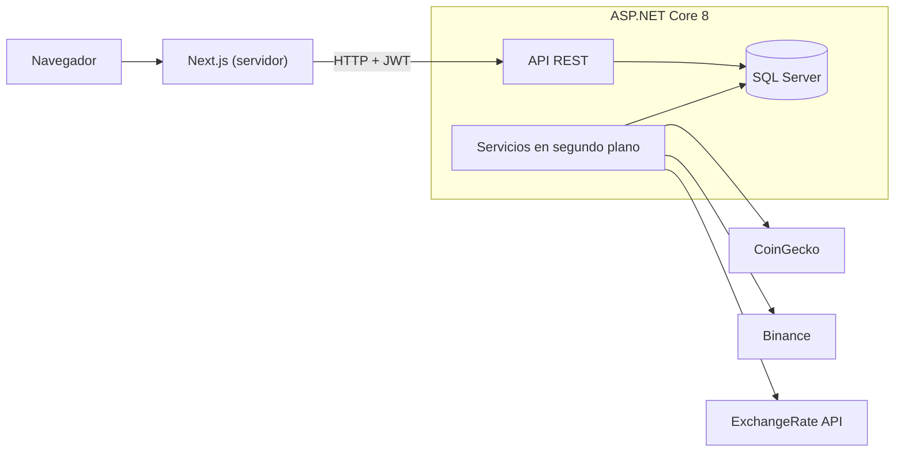

# Portafolio Cripto


Diario manual de portafolios de criptomonedas, inspirado en la sección *Portfolio* de CoinMarketCap. No se conecta a ningún exchange: registras tus operaciones y la aplicación calcula posiciones, coste, ganancias y evolución del valor, con precios de CoinGecko y Binance.

## Características

- **Varios portafolios** por usuario, con uno predeterminado. Se pueden crear, renombrar, duplicar, reordenar y mover monedas entre ellos.
- **Transacciones**: compra, venta, transferencia entrante y transferencia saliente, con comisión, fecha y nota.
- **Coste FIFO** con ganancia realizada y no realizada por moneda.
- **Vista general** con valor total, distribución por moneda, mejores y peores rendimientos, gráfico histórico y comparación con Bitcoin.
- **Exportación** del historial de transacciones y del resumen del portafolio en CSV (formato estándar o para Excel), también en ZIP.
- **Seguimiento** de monedas y **alertas de precio** (por encima o por debajo de un objetivo) con aviso en la campana de la cabecera.
- **Precios actualizados cada pocos segundos** (Binance), catálogo de las 500 principales monedas (CoinGecko) e histórico diario.
- **Moneda de visualización**: todo se guarda en USD y el selector (USD, EUR, PEN, CLP) solo convierte al mostrar.
- **Tema claro y oscuro**.
- **Autenticación** con JWT de vida corta y refresh token de un solo uso, guardados en cookies `httpOnly`.

## Arquitectura



- El navegador **nunca habla con la API de .NET**: todas las peticiones pasan por el servidor de Next.js, que añade el token de la sesión y renueva el JWT con el refresh token antes de que caduque.
- El frontend **solo lee de la API propia**. CoinGecko, Binance y el servicio de tipos de cambio los consulta únicamente el backend, mediante servicios en segundo plano que guardan los datos en SQL Server.
- La API sigue una **arquitectura limpia** (`Domain`, `Application`, `Infrastructure`, `Api`). La lógica de coste FIFO vive en el dominio como código puro, sin dependencias de EF ni de HTTP.
- Los importes se guardan en USD con `decimal` de alta precisión (hasta 18 decimales en precios unitarios).

## Estructura del repositorio

```
.
├── backend/                  API en ASP.NET Core 8
│   ├── src/
│   │   ├── CriptoPortfolio.Api             Controladores, autenticación, límites de peticiones, Swagger
│   │   ├── CriptoPortfolio.Application     Contratos y modelos de los casos de uso
│   │   ├── CriptoPortfolio.Domain          Entidades y cálculo de coste (FIFO / media)
│   │   └── CriptoPortfolio.Infrastructure  EF Core, Identity, proveedores externos y workers
│   └── tests/CriptoPortfolio.Tests         Pruebas xUnit
└── frontend/                 Aplicación Next.js 16 (App Router)
    ├── app/                  Rutas
    ├── features/             Código por funcionalidad (portfolio, watchlist, alerts, auth, market, currency)
    ├── shared/               Componentes y utilidades comunes
    └── tests/                Pruebas de la lógica
```

Cada parte tiene su propio README con más detalle: [backend](backend/README.md) y [frontend](frontend/README.md).

## Requisitos

- [.NET SDK 8](https://dotnet.microsoft.com/download/dotnet/8.0)
- SQL Server en local (la cadena por defecto usa `Server=localhost` con autenticación de Windows)
- [Node.js](https://nodejs.org/) 22 o superior
- Una clave gratuita (*Demo*) de [CoinGecko](https://www.coingecko.com/en/api) (opcional, pero evita límites de uso)

## Puesta en marcha

Los comandos son para Windows PowerShell.

**1. API**

```powershell
cd backend\src\CriptoPortfolio.Api
dotnet user-secrets set "Jwt:SigningKey" "<clave aleatoria de al menos 32 caracteres>"
dotnet user-secrets set "CoinGecko:ApiKey" "<tu clave de CoinGecko>"
dotnet run
```

En desarrollo la base de datos se crea y se migra sola al arrancar. La API queda en <http://localhost:5080> y Swagger en <http://localhost:5080/swagger>.

**2. Frontend**, en otra terminal:

```powershell
cd frontend
copy .env.example .env.local
npm install
npm run dev
```

Abre <http://localhost:3000>, crea una cuenta y registra tu primera transacción.

Las claves nunca se guardan en el repositorio: la API las lee de `dotnet user-secrets` en local o de variables de entorno (`Jwt__SigningKey`, `CoinGecko__ApiKey`) en otros entornos.

## Pruebas

```powershell
cd backend
dotnet test

cd ..\frontend
npm test
npm run typecheck
npm run build
```

Las pruebas del backend usan SQLite en memoria, así que no necesitan SQL Server.

## Hoja de ruta

- Integración continua con GitHub Actions (`dotnet test` y `npm test` en cada pull request).
- Contenedores Docker y despliegue en un VPS.
- Alertas de precio por correo electrónico.
- Checklist de pruebas de extremo a extremo antes de publicar.

## Autor

Richard · [@alexggdev](https://github.com/alexggdev)
